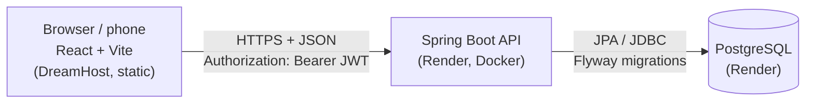

# Circuit Trainer

A mobile-first workout app I built for my own weight-loss and strength training at home:
guided circuit timers, a 12-week kettlebell program, per-set logging, body-weight tracking
and goals. A **React** frontend backed by a **Spring Boot** REST API and **PostgreSQL**.

**Stack:** Java 21 · Spring Boot 4.1 · Spring Security (JWT) · Spring Data JPA / Hibernate ·
PostgreSQL · Flyway · Testcontainers · React 19 · Vite · Docker · Render · GitHub Actions.
No Lombok, on purpose: every constructor, getter and query is visible.



## Features

**Training**
- Two workout modes: **timed** (auto-advancing countdowns with 3-2-1 audio cues) and
  **manual** (self-paced sets with a rest stopwatch and target)
- Seven built-in workouts, including a 3-month single-kettlebell program
- **Custom workouts**: copy a built-in and edit it, or build one from scratch
- Calendar-based **"Week 2 of 4"** program tracking, in the user's own time zone
- Screen wake lock, resume after refresh, works offline: a finished workout is queued on
  the device and synced on next launch

**Tracking**
- **Per-set logging** (reps, weight, duration) after each workout, pre-filled from the plan
  and from the weights used last time
- **Body-weight log** with a trend chart
- **Goals**: target weight (loss or gain) and workouts per week, with live progress
- **Stats**: totals, time trained, training volume, per-workout counts
- Backup/restore as JSON, and a one-time import of history saved before accounts existed

**API**
- JWT **authentication**; every user sees only their own data (other users' ids are 404s)
- Full **CRUD** for workouts, sessions, weights and goals; layered `Controller → Service → Repository`
- **Validation** on requests (including nested lists) plus **business rules** returned as 422s
- Consistent errors as [RFC 9457](https://www.rfc-editor.org/rfc/rfc9457) Problem Details
- **Filtering, pagination** and whitelisted sorting on history
- **HTML sanitizing** (jsoup allowlist) for workout descriptions the frontend renders
- **CORS** limited to the frontend's origin
- **OpenAPI** docs with Swagger UI at `/swagger-ui.html`
- **Tests** at every level against real Postgres; **Docker** image; **CI** for server and client

## API

All endpoints except `/api/v1/auth/**` and `/actuator/health` need `Authorization: Bearer <token>`.

| Method | Path | Description |
|---|---|---|
| POST | `/api/v1/auth/register` | Create an account, returns a token |
| POST | `/api/v1/auth/login` | Returns a token (valid 12 hours) |
| GET / DELETE | `/api/v1/me` | Your account / delete it (password required) |
| GET / POST | `/api/v1/workouts` | Built-ins + your workouts / create one |
| GET / PUT / DELETE | `/api/v1/workouts/{id}` | Read / replace / delete (built-ins are read-only: 403) |
| POST | `/api/v1/workouts/{id}/copy` | Copy any visible workout into your own |
| GET / POST | `/api/v1/sessions` | Search history (`workoutId`, `from`, `to`, paging) / log a workout |
| GET / PUT / DELETE | `/api/v1/sessions/{id}` | Read / replace (incl. sets) / delete |
| GET | `/api/v1/sessions/export` | Full history with sets, for backup |
| POST | `/api/v1/sessions/import` | Idempotent bulk import (duplicates skipped) |
| GET / POST | `/api/v1/weights` | Weight log (`from`, `to`, paging) / log a weigh-in |
| GET / PUT / DELETE | `/api/v1/weights/{id}` | Read / replace / delete |
| GET / POST | `/api/v1/goals` | Goals with live progress / create one |
| GET / PUT / DELETE | `/api/v1/goals/{id}` | Read / replace / delete |
| GET | `/api/v1/stats` | Dashboard numbers |

`/goals` and `/stats` take `?tz=America/New_York` (IANA id): "today" and "this week" depend on it.

### Example

```bash
API=localhost:8080/api/v1
TOKEN=$(curl -s -X POST $API/auth/register -H 'Content-Type: application/json' \
  -d '{"username":"hassan","password":"correct-horse"}' | jq -r .accessToken)

curl -s -X POST $API/sessions -H "Authorization: Bearer $TOKEN" -H 'Content-Type: application/json' \
  -d '{"workoutId":5,"totalSeconds":1500,"sets":[
        {"exerciseTitle":"Two-Hand Swing","setLabel":"Set 1 of 5","reps":15,"weightLb":35}]}'
```

```json
{
  "id": 1,
  "workoutId": 5,
  "workoutTitle": "Kettlebell Month 1 - Foundation",
  "completedAt": "2026-10-03T12:41:09.708309Z",
  "totalSeconds": 1500,
  "notes": null,
  "volumeLb": 525,
  "sets": [{ "exerciseTitle": "Two-Hand Swing", "setLabel": "Set 1 of 5", "reps": 15,
             "weightLb": 35, "durationSeconds": null }]
}
```

Errors share one shape:

```json
{
  "type": "about:blank",
  "title": "Business rule violated",
  "status": 422,
  "detail": "Every exercise in a TIMED workout needs durationSeconds ('Squat' has none)",
  "instance": "/api/v1/workouts"
}
```

## Running locally

Requirements: JDK 21, Node 22 with Yarn 4 (via `corepack enable`), PostgreSQL
(e.g. [Postgres.app](https://postgresapp.com)). Docker is optional.

```bash
# API on :8080
createdb circuit_trainer
cp server/src/main/resources/application-local.properties.example \
   server/src/main/resources/application-local.properties   # then set JWT_SECRET
cd server && ./mvnw spring-boot:run -Dspring-boot.run.profiles=local
```

```bash
# Frontend on :5173
cd client && yarn install && yarn dev
```

Flyway creates the schema and the built-in workouts on first start. Swagger UI:
http://localhost:8080/swagger-ui.html (register, click **Authorize**, paste the token).

| Variable | Default | Purpose |
|---|---|---|
| `DB_URL` | built from the parts below | Full JDBC URL (overrides the parts) |
| `DB_HOST` / `DB_PORT` / `DB_NAME` | `localhost` / `5432` / `circuit_trainer` | Database location |
| `DB_USERNAME` / `DB_PASSWORD` | `postgres` / *(empty)* | Database credentials |
| `JWT_SECRET` | **none** | HMAC key for signing tokens, 32+ bytes; the app won't start without it |
| `JWT_TTL` | `PT12H` | Token lifetime (ISO-8601 duration) |
| `CORS_ALLOWED_ORIGINS` | `http://localhost:5173` | Comma-separated frontend origins |
| `DB_POOL_SIZE` | `5` | Hikari connection pool size |
| `PORT` | `8080` | HTTP port |

## Tests

```bash
cd server
./mvnw test                                                              # with Docker: Testcontainers
TEST_DB_URL=jdbc:postgresql://localhost:5432/circuit_trainer_test ./mvnw test   # without Docker
```

| Level | Tools | What it covers |
|---|---|---|
| Unit | JUnit 5, Mockito, AssertJ | Goal maths, calendar weeks and time zones, sanitizer, ownership and read-only rules, import de-duplication, login timing |
| Web slice | `@WebMvcTest` + real security config | Status codes, nested validation errors, 401/403/404 mapping, CORS preflight |
| Repository | `@DataJpaTest` + real Postgres | Flyway seed, visibility queries, partial unique index, `ON DELETE SET NULL`, aggregates, `CHECK` constraints |
| End to end | `@SpringBootTest` + real Postgres | Register → log → stats; users isolated; account deletion; forged tokens |

Database tests run against real PostgreSQL, never H2, so they exercise the same SQL, constraints
and migrations as production. They use a Testcontainers Postgres when Docker is available,
or an existing database when `TEST_DB_URL` is set, and are skipped otherwise. CI always runs them.

## Deployment

- **API → Render.** [`render.yaml`](render.yaml) is a Blueprint: in Render choose **New → Blueprint**,
  pick this repo, and enter the frontend's origin for `CORS_ALLOWED_ORIGINS`. Render provisions a free
  Postgres, builds [`server/Dockerfile`](server/Dockerfile), and generates `JWT_SECRET`.
  Free services sleep when idle; the app shows a "waking up the server" notice on slow first requests.
- **Frontend → DreamHost.** Copy `client/.env.production.local.example` to
  `client/.env.production.local` with the Render URL, then `yarn deploy` (builds and rsyncs `dist/`).

## Design notes

- **Owner-scoped queries.** Every lookup includes the owner, so another user's id is a `404`, not a
  `403`, and ids can't be probed. Built-ins are the one exception: visible to all, so editing one is
  an honest `403` with a hint to copy it.
- **Built-ins are rows with `owner_id = null`,** seeded by a Flyway migration. Titles are unique among
  built-ins and per user (case-insensitive) via **partial unique indexes**.
- **History survives edits.** A session stores a snapshot of the workout title and set names, and
  its `workout_id` is `ON DELETE SET NULL`, so deleting a workout never deletes the record of doing it.
- **No N+1, no in-memory paging.** Lazy collections load with Hibernate batch fetching
  (`default_batch_fetch_size`): a page of sessions with their sets is two queries, and paging stays in SQL.
- **Aggregates in the database.** Stats are `count`/`sum`/`min`/`max` with `group by`, mapped straight
  into records with JPQL constructor expressions.
- **Time zones are explicit.** Instants are stored in UTC; "this week" and program weeks are computed
  in the zone the client sends. Body weight uses a plain `DATE`. "Now" comes from an injected `Clock`.
- **Two layers of constraints.** Bean Validation gives readable 400s; Postgres `CHECK`s and unique
  constraints are the backstop.
- **Idempotent import.** `(owner, workout title, completed at)` is unique, so importing the same
  backup twice, or an offline retry arriving twice, can't create duplicates.
- **Stored-XSS defence.** Descriptions are rendered as HTML by the client, so the API sanitizes them
  against an allowlist before they are stored.
- **Stateless JWT.** HS256 tokens verified by Spring Security's resource server; BCrypt passwords; login
  takes the same time for unknown users and wrong passwords.

## Project structure

```
client/                      React app (see client/README.md)
server/
├── src/main/java/com/hassanhibbert/circuit_trainer
│   ├── auth/                register/login
│   ├── config/              OpenAPI, Clock
│   ├── controller/          REST controllers (thin: HTTP in, DTO out)
│   ├── dto/                 request/response records, filters, paging, stats
│   ├── entity/              JPA entities and enums
│   ├── exception/           domain exceptions + global ProblemDetail handler
│   ├── repository/          Spring Data repositories, specifications, projections
│   ├── security/            security filter chain, CORS, JWT, @CurrentUserId
│   └── service/             business logic, transactions, week/goal calculations
├── src/main/resources/db/migration   Flyway migrations (V3 seeds the built-in workouts)
└── scripts/                 seed generator and the original workout JSON
render.yaml                  Render Blueprint (API + Postgres)
.github/workflows/ci.yml     CI: server tests + Docker build, client lint + build
```
