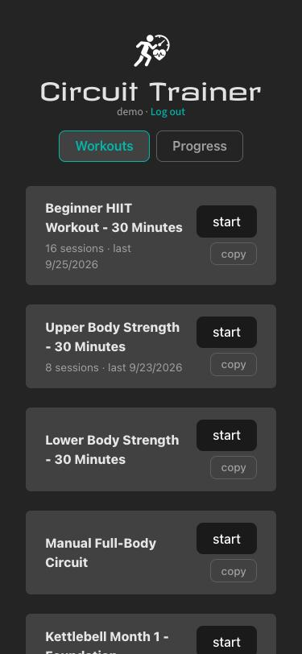
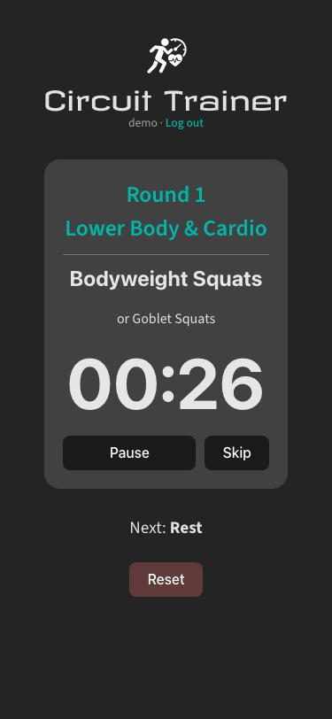
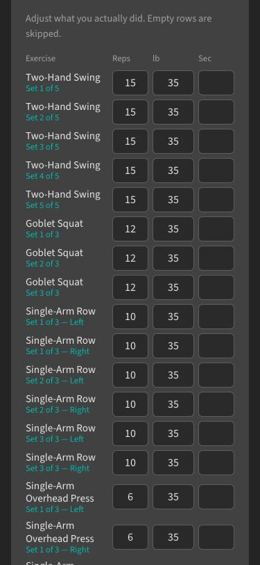
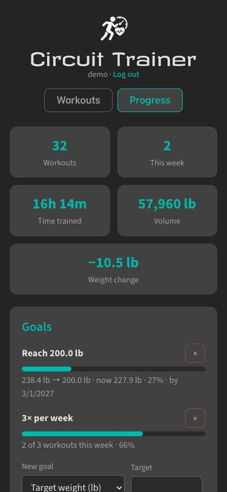
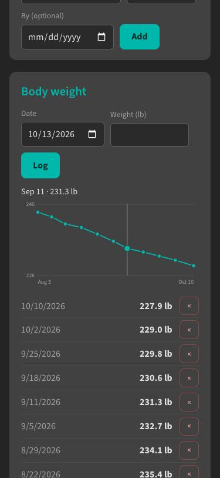
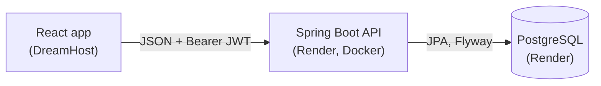

# Circuit Trainer

Workout app I built for my own weight loss and strength training at home. Circuit timers, a
12 week kettlebell program, per-set logging, body weight tracking and goals.

React frontend, Spring Boot API, PostgreSQL.

**Live:** [trainer.hassanhibbert.com](https://trainer.hassanhibbert.com) (the API is on Render's free tier, so the
first request after a while can take up to a minute)

| Workouts | Timer | Log sets | Progress | Weight |
|---|---|---|---|---|
|  |  |  |  |  |

**Stack:** Java 21, Spring Boot 4.1, Spring Security (JWT), Spring Data JPA, PostgreSQL, Flyway,
Testcontainers, React 19, Vite, Docker, Render, GitHub Actions. No Lombok.



## Features

- Timed workouts (countdowns with 3-2-1 beeps) and manual workouts (go at your own pace, rest timer between sets)
- 7 built-in workouts including a 3 month kettlebell program
- Custom workouts: copy a built-in and edit it, or make your own
- "Week 2 of 4" tracking based on the calendar, in your time zone
- Log reps and weight after each workout, prefilled from the plan and from last time
- Body weight log with a chart
- Goals for target weight and workouts per week
- Stats: total workouts, time trained, volume
- Works offline: a finished workout is saved on the device and synced next time the app opens
- Backup/restore, and a one time import of history saved before accounts existed

## API

Everything except `/api/v1/auth/**` and `/actuator/health` needs `Authorization: Bearer <token>`.

| Method | Path | Description |
|---|---|---|
| POST | `/api/v1/auth/register` | Create an account, returns a token |
| POST | `/api/v1/auth/login` | Returns a token (valid 12 hours) |
| GET / DELETE | `/api/v1/me` | Your account / delete it (needs your password) |
| GET / POST | `/api/v1/workouts` | Built-ins + your workouts / create one |
| GET / PUT / DELETE | `/api/v1/workouts/{id}` | Built-ins are read-only (403) |
| POST | `/api/v1/workouts/{id}/copy` | Copy a workout into your own |
| GET / POST | `/api/v1/sessions` | History (`workoutId`, `from`, `to`, paging) / log a workout |
| GET / PUT / DELETE | `/api/v1/sessions/{id}` | PUT replaces the sets too |
| GET | `/api/v1/sessions/export` | Full history for backup |
| POST | `/api/v1/sessions/import` | Bulk import, duplicates are skipped |
| GET / POST | `/api/v1/weights` | Weight log (`from`, `to`, paging) / add one |
| GET / PUT / DELETE | `/api/v1/weights/{id}` | |
| GET / POST | `/api/v1/goals` | Goals with progress / add one |
| GET / PUT / DELETE | `/api/v1/goals/{id}` | |
| GET | `/api/v1/stats` | Dashboard numbers |

`/goals` and `/stats` take `?tz=America/New_York` since "this week" depends on where you are.

Swagger UI is at `/swagger-ui.html`.

```bash
API=localhost:8080/api/v1
TOKEN=$(curl -s -X POST $API/auth/register -H 'Content-Type: application/json' \
  -d '{"username":"hassan","password":"correct-horse"}' | jq -r .accessToken)

curl -s -X POST $API/sessions -H "Authorization: Bearer $TOKEN" -H 'Content-Type: application/json' \
  -d '{"workoutId":5,"totalSeconds":1500,"sets":[
        {"exerciseTitle":"Two-Hand Swing","setLabel":"Set 1 of 5","reps":15,"weightLb":35}]}'
```

Errors come back as [problem details](https://www.rfc-editor.org/rfc/rfc9457):

```json
{
  "type": "about:blank",
  "title": "Business rule violated",
  "status": 422,
  "detail": "Every exercise in a TIMED workout needs durationSeconds ('Squat' has none)",
  "instance": "/api/v1/workouts"
}
```

## Running locally

Needs JDK 21, Node 24+ with Yarn 4 (`corepack enable`) and Postgres ([Postgres.app](https://postgresapp.com) works).

```bash
createdb circuit_trainer
cp server/.env.server.local.example server/.env.server.local   # fill it in
cd server && ./mvnw spring-boot:run
```

```bash
cd client && yarn install && yarn dev
```

Config comes from environment variables. Locally `server/.env.server.local` fills in anything
that isn't set (run the API from `server/` so it finds the file).

| Variable | Default | |
|---|---|---|
| `DB_URL` | built from the parts below | full JDBC url |
| `DB_HOST` / `DB_PORT` / `DB_NAME` | | required unless `DB_URL` is set |
| `DB_USERNAME` / `DB_PASSWORD` | | |
| `JWT_SECRET` | | 32+ bytes, the app won't start without it |
| `JWT_TTL` | `PT12H` | |
| `CORS_ALLOWED_ORIGINS` | `http://localhost:5173` | comma separated |
| `DB_POOL_SIZE` | `5` | |
| `PORT` | `8080` | |

## Tests

```bash
cd server
./mvnw test
TEST_DB_URL=jdbc:postgresql://localhost:5432/circuit_trainer_test ./mvnw test   # no Docker
```

Unit tests with Mockito, `@WebMvcTest` controller tests, `@DataJpaTest` repository tests and a few
`@SpringBootTest` end to end tests. The database tests run against real Postgres (Testcontainers,
or `TEST_DB_URL` if you don't have Docker) and get skipped if neither is available.

## Deployment

- API: `render.yaml` is a Render blueprint (New > Blueprint). It creates the database, builds
  `server/Dockerfile` and generates `JWT_SECRET`. Set `CORS_ALLOWED_ORIGINS` to the frontend url.
  The free tier sleeps, so the first request can take a while.
- Frontend: copy `client/.env.production.local.example` to `.env.production.local` with the Render
  url, then `yarn deploy` from `client/`.

## Notes

- Every query is scoped to the logged in user, so someone else's id is a 404.
- Built-in workouts are rows with a null owner, seeded by a Flyway migration.
- Sessions keep a copy of the workout title and `workout_id` is `on delete set null`, so deleting a
  workout doesn't delete its history.
- Lazy collections use batch fetching instead of fetch joins so paging stays in SQL.
- Stats are aggregated in the database with JPQL constructor expressions.
- Workout descriptions are rendered as HTML, so they're sanitized with jsoup before being saved.
- `(owner, workout title, completed at)` is unique, which makes imports and offline retries safe to repeat.

## Structure

```
client/                      React app
server/
├── src/main/java/.../circuit_trainer
│   ├── auth/                register/login
│   ├── config/
│   ├── controller/
│   ├── dto/
│   ├── entity/
│   ├── exception/
│   ├── repository/
│   ├── security/            JWT, CORS
│   └── service/
├── src/main/resources/db/migration
└── scripts/                 seed generator + original workout JSON
render.yaml
.github/workflows/ci.yml
```
